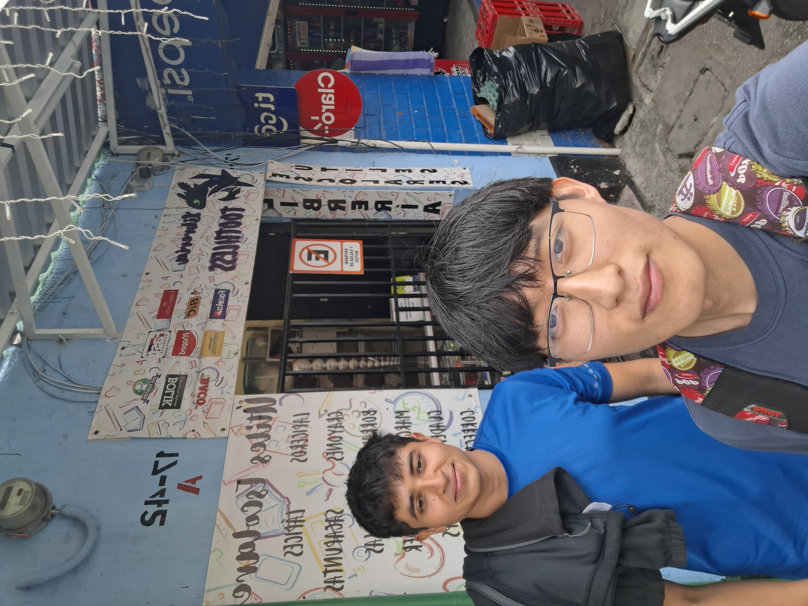

# Enlaces de los audios de las entrevistas y las fotografías del equipo con el entrevistado (o frente al negocio)

## Grupo 1 - 3 Integrantes  Aimar, Naomi y Deenis  
**Justificación y Descripción:**  
Entrevista realizada en el taller mecánico del familiar de Dennis. En este audio se recopila la información sobre el control operativo y los problemas diarios. La fotografía muestra al equipo realizando la visita presencial en el lugar.  

**Escuchar Entrevista 1:** 
[▶ Reproducir / Descargar Audio 1](media/AUD-20261010-WA0034.m4a)  

### Imagen  

## Grupo 2 - 2 Integrantes  Hassan y Carlos  
**Justificación y Descripción:**  
Entrevista realizada en una librería localizada  por Hassan y Carlos. El audio detalla las necesidades de registro y atención al cliente detectadas. La fotografía evidencia la presencia del equipo en el lugar entrevistado.

**Escuchar Entrevista 2:**  
[▶ Reproducir / Descargar Audio 2](media/05-10-2026%2011.45.m4a)  

### Imagen 

