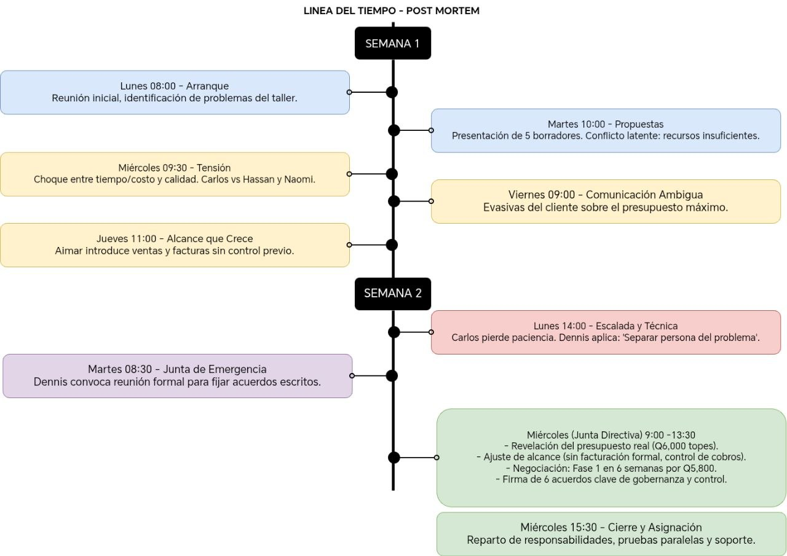

# Documento Post-Mortem
## Proyecto Autosemec — Sistema de gestión para el taller mecánico de don Rony Payes

---

## 1. Resumen del incidente

Durante las primeras semanas de implementación de la solución tecnológica para el taller mecánico Autosemec, propiedad de don Rony Payes, el equipo de proyecto enfrentó un incidente que puso en riesgo la viabilidad de todo el plan. El problema de fondo fue claro: el equipo tenía cinco propuestas buenas sobre la mesa — control de repuestos, presupuesto claro, expediente digital, agenda inteligente y asistente en el celular — pero no podía construirlas todas con el tiempo y el dinero disponibles. Había que decidir qué se hacía, hasta dónde se llegaba y qué se sacrificaba.

Lo que comenzó como diferencias normales de criterio entre los integrantes del equipo fue escalando día a día hasta convertirse en tres conflictos concretos que amenazaron con paralizar el proyecto.

El primer conflicto fue la tensión entre tiempo y costo contra calidad. Carlos, responsable del plazo y presupuesto, venía presionando desde los primeros días para entregar resultados rápidos y visibles. Quería que en cuatro semanas don Rony ya tuviera algo funcionando. Hassan y Naomi, por su parte, insistían en que entregar funciones a medias o sin pruebas sería peor que no entregar nada, porque si el sistema fallaba, don Rony perdería la confianza y simplemente dejaría de usarlo. Esta diferencia de visión generó roces que fueron subiendo de tono con el paso de los días, hasta que en una discusión directa Carlos dijo que "siempre es lo mismo con los técnicos: todo es imposible", momento en el que Dennis tuvo que intervenir para reconducir la conversación.

El segundo conflicto fue el crecimiento del alcance. A medida que avanzaban los días y el equipo iba definiendo las funcionalidades, Aimar — quien representaba a don Rony — fue introduciendo solicitudes que no estaban en la entrevista original. Primero fueron detalles menores, pero luego pidió que se agregaran ventas y facturas, lo cual implicaba un módulo completo con reglas de impuestos y múltiples pantallas. Esto tomó por sorpresa al equipo, porque incorporar eso habría puesto en riesgo todo lo que ya se había planificado. Carlos reaccionó con firmeza, Hassan advirtió que era otro sistema completo, y Naomi lo registró como un riesgo de alcance sin control.

El tercer conflicto fue la comunicación poco clara del cliente. A lo largo de los días, Aimar tendía a responder con frases como "lo que ustedes digan está bien" o "ustedes son los expertos", evitando comprometerse con respuestas directas. El problema era que don Rony sí tenía prioridades definidas y un tope de presupuesto de Q6,000 que Aimar no comunicó con claridad hasta que Dennis lo confrontó directamente. Esta falta de información retrasó decisiones clave y provocó que el equipo trabajara durante días sobre opciones que resultaron ser inviables desde el inicio.

La combinación de estos tres conflictos — la presión por velocidad chocando con la defensa de la calidad, un alcance que crecía sin control y un canal de comunicación con el cliente que no transmitía la información completa — llevó al equipo a convocar una junta de emergencia para resolver la situación antes de que el proyecto se descarrilara por completo.

---

## 2. Línea de tiempo (timeline)

- Lunes 8:00 AM – Arranque del proyecto: El equipo se reunió por primera vez para revisar el informe de la entrevista con don Rony. Se identificaron los problemas principales del taller: pérdida de tiempo buscando repuestos y recogiendo carros, información guardada solo en la memoria y el teléfono de don Rony, presupuestos que no quedaban por escrito, falta de control del espacio en el taller y errores por distracción. Cada integrante comenzó a trabajar en su propuesta individual.

- Martes 10:00 AM – Primeras propuestas en borrador: Carlos presentó su idea de control de repuestos, Hassan la de presupuesto claro por mensaje, Aimar la del expediente digital, Naomi la de agenda inteligente con control de espacio, y Dennis la del asistente en el celular. Las cinco propuestas eran buenas, pero ya se notaba que no cabían todas en un solo plan.

- Miércoles 9:30 AM – Primeras señales de tensión: Carlos empezó a presionar para definir fechas concretas. Pidió que se entregaran repuestos y presupuestos en cuatro semanas. Hassan expresó su preocupación de que hacer cinco funciones en ese plazo resultaría en entregas a medias. Naomi respaldó a Hassan y advirtió que un sistema que guardara mal los datos o calculara mal un presupuesto haría más daño que no tener sistema. Carlos interpretó esto como resistencia y el tono de las conversaciones empezó a subir.

- Jueves 11:00 AM – Aimar introduce cambios de alcance: Aimar comunicó que don Rony también quería ventas y facturas, funcionalidades que no habían aparecido en la entrevista original. Carlos reaccionó con firmeza: "Si cada semana agregamos algo nuevo, nunca terminamos." Hassan señaló que ventas y facturas era otro sistema completo, con reglas de impuestos y muchas pantallas. Naomi lo registró en su reporte de riesgos como alcance que crecía sin control. Aimar se retrajo diciendo "si no se puede, no pasa nada", pero la tensión quedó en el aire.

- Viernes 9:00 AM – Comunicación ambigua del cliente se vuelve un problema: El equipo necesitaba saber el presupuesto máximo de don Rony para poder tomar decisiones. Aimar respondió con evasivas: "lo que ustedes digan", "ustedes son los expertos". Dennis notó que Aimar evitaba dar respuestas concretas y que esto estaba retrasando decisiones fundamentales. Mientras tanto, Hassan calculó que las cinco funciones completas costarían Q7,000 en ocho semanas o Q8,500 en cuatro semanas, pero sin saber el tope del cliente, no había forma de decidir.

- Lunes 2:00 PM – Escalada del conflicto tiempo vs. calidad: En una discusión sobre prioridades, Carlos perdió la paciencia y dijo: "Siempre es lo mismo con ustedes, los técnicos: todo es imposible. Yo estoy pidiendo resultados, no un discurso." Dennis intervino de inmediato, le pidió que separara la persona del problema y que reformulara su mensaje. Carlos respiró, bajó el tono y se disculpó: "Tienes razón. Lo reformulo: me preocupa que nos pasemos de fecha y de presupuesto. Necesito que me digan qué sí se puede entregar en cuatro semanas." Naomi respondió que no aprobaría ninguna entrega sin pruebas, pero propuso que fueran solo dos días de pruebas enfocadas en lo crítico, no tres meses como Carlos temía.

- Martes 8:30 AM – Dennis convoca junta de emergencia: Ante la acumulación de conflictos sin resolver, Dennis decidió convocar una junta formal con todos los integrantes para el día siguiente. El objetivo era claro: no salir de esa reunión sin acuerdos escritos y firmados sobre qué se iba a construir, en cuánto tiempo, con qué presupuesto y qué se dejaba fuera.

- Miércoles 9:00 AM – Junta directiva: apertura y revelación del presupuesto real: Dennis abrió la reunión estableciendo reglas: hablar uno a la vez, con respeto, y salir con acuerdos claros. Confrontó directamente a Aimar sobre el presupuesto: "Necesito que seas claro porque esto cambia la decisión. ¿Q6,000 es el tope, sí o no?" Aimar finalmente confirmó que sí, que Q6,000 era el tope y que don Rony prefería entregas por partes. Con ese dato sobre la mesa, quedó claro que las cinco funciones completas no cabían en el presupuesto sin bajar la calidad.

- Miércoles 10:30 AM – Junta directiva: resolución del alcance: Dennis le preguntó a Aimar qué quería resolver realmente don Rony con las ventas y facturas. Aimar aclaró que no necesitaba facturación formal, solo saber cuánto cobró por cada trabajo y cuánto le debían. Hassan propuso registrar eso dentro del presupuesto, sin costo adicional ni cambio en el calendario.

El equipo también acordó que el hijo de don Rony usaría el sistema, y Naomi propuso que cada anotación quedara con nombre y hora para trazabilidad.

- Miércoles 12:00 PM – Junta directiva: negociación y trade-offs: Hassan propuso dividir el proyecto en dos fases. La fase 1 incluiría expediente digital, lista de repuestos, presupuesto con registro de cobro y una agenda simple, todo dentro del asistente en el celular, en seis semanas por Q5,800. Carlos pidió reducir a cinco semanas, pero Naomi se negó a firmar si se sacrificaban las pruebas. Propuso hacer pruebas en paralelo al desarrollo, lo cual permitía mantener las seis semanas sin recortar calidad. Carlos aceptó: "Es más tiempo del que quería, pero se ve un plan serio."

- Miércoles 1:30 PM – Junta directiva: calendario de entregas: Naomi definió el plan: Semana 2, expediente digital y lista de repuestos; Semana 4, presupuesto con cobro y botón de mensaje; Semana 6, agenda simple con control de espacio, ajustes y capacitación. Aimar expresó su miedo de que don Rony no supiera usar el sistema. Hassan incluyó una sesión de capacitación en el taller y un mes de soporte por mensaje, dentro del presupuesto de Q5,800.

- Miércoles 3:00 PM – Junta directiva: acuerdos firmados y cierre: Se firmaron seis acuerdos que cubrían alcance, entregas bisemanales, control de cambios, protección de datos, capacitación con soporte por un mes, y señales de alerta. Cada integrante asumió una responsabilidad concreta y firmó el acta. El proyecto quedó Q200 por debajo del tope de don Rony, dejando un margen para imprevistos.

---

## 3. Impacto

Los tres conflictos que se desarrollaron a lo largo de los días tuvieron un impacto real sobre el proyecto, el equipo y el cliente.

Impacto sobre el equipo de desarrollo:
La tensión acumulada entre Carlos y el resto del equipo técnico deterioró la dinámica de trabajo durante casi una semana y media. El choque entre la urgencia por entregar rápido y la defensa de la calidad generó un ambiente donde las propuestas se recibían con desconfianza en lugar de colaboración. Hubo un momento el lunes de la segunda semana en que la comunicación se volvió agresiva y Dennis tuvo que mediar para evitar que la relación profesional se dañara. Si este conflicto no se hubiera resuelto en la junta del miércoles, el equipo habría seguido trabajando bajo presión excesiva, aumentando la probabilidad de errores, entregas defectuosas y posiblemente la renuncia de algún integrante.

Impacto sobre el alcance del proyecto:
La solicitud de Aimar el jueves de incluir ventas y facturas amenazó con desbordar el alcance de todo el proyecto. Si se hubiera aceptado sin análisis, el equipo habría asumido un módulo completo con reglas de impuestos y múltiples pantallas que no estaba planificado, lo que habría retrasado las entregas y superado el presupuesto. El impacto real fue que durante varios días el equipo discutió sobre funcionalidades que no correspondían al problema original, perdiendo tiempo valioso de planificación. Gracias a la intervención de Dennis durante la junta, se descubrió que la necesidad real era mucho más simple — registrar cuánto se cobró y cuánto se debían — y se integró sin costo adicional.

Impacto sobre el cliente (don Rony Payes):
La comunicación ambigua de Aimar retrasó decisiones fundamentales desde el martes de la primera semana hasta el miércoles de la segunda. El equipo no supo hasta la junta de emergencia que el presupuesto tenía un tope de Q6,000, lo que significó que las primeras opciones discutidas (Q7,000 y Q8,500) eran inviables desde el inicio. Si Aimar no hubiera aclarado esto, el equipo podría haber planificado y comenzado a construir una solución que don Rony no podía pagar, generando frustración, retrabajo y posiblemente la cancelación del proyecto. Además, don Rony estuvo varios días sin recibir información clara sobre qué iba a recibir ni cuándo, lo que pudo haber erosionado su confianza en el equipo.

Impacto sobre el calendario:
La combinación de los tres conflictos consumió una semana y media que debió haberse dedicado a la construcción del sistema. Lo que Carlos esperaba resolver en cuatro semanas terminó siendo un proyecto de seis semanas dividido en fases, con entregas cada dos semanas y pruebas en paralelo. Aunque el resultado final fue un plan más sólido y realista, el retraso en la toma de decisiones significó que el proyecto arrancó tarde y con menos margen para imprevistos.

Impacto indirecto sobre la confianza:
Si los conflictos no se hubieran abordado abiertamente en la junta de emergencia del miércoles, el equipo habría salido con acuerdos frágiles basados en suposiciones. La falta de claridad en la comunicación del cliente, combinada con expectativas de velocidad poco realistas y un alcance en crecimiento, habría generado incumplimientos en las primeras entregas, erosionando la confianza tanto dentro del equipo como con don Rony. El taller habría terminado con un sistema a medias que nadie usaría, confirmando el temor de Naomi: "Un sistema perfecto que nadie usa es un sistema fallido."